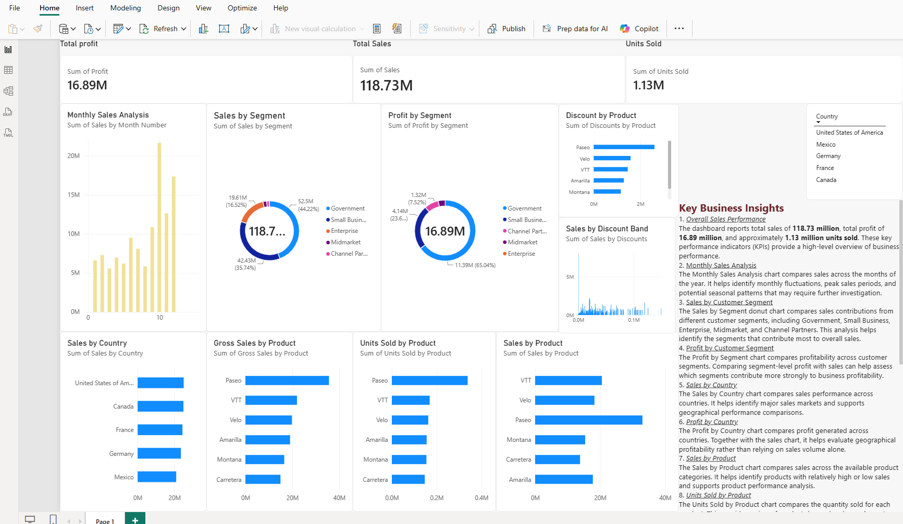

## Dashboard Preview

# Sales Data Analytics Dashboard

## Project Overview
This project is an interactive Sales Data Analytics Dashboard developed using Microsoft Power BI. It explores sales, profit, units sold, product performance, customer segments, countries, and discount bands using a sample Financials dataset.

## Key Performance Indicators (KPIs)

| KPI | Value |
|---|---:|
| Total Sales | 118.73M |
| Total Profit | 16.89M |
| Units Sold | 1.13M |

## Tools and Technologies
- Microsoft Power BI Desktop
- Power Query
- Data Visualization
- Business Intelligence

## Dashboard Features
- Monthly Sales Analysis
- Sales by Segment
- Sales by Country
- Profit by Segment
- Profit by Country
- Sales by Product
- Sales by Discount Band
- Units Sold by Product
- Gross Sales by Product
- Discounts by Product
- Interactive Country Slicer

## Project Objectives
- Analyze sales and profitability metrics.
- Compare product and country performance.
- Explore sales distribution across customer segments.
- Understand discount patterns and monthly sales trends.
- Present business data through interactive visualizations.

## Dataset
This project uses the sample Financials dataset available in Power BI. The results represent sample data and do not describe a real company's financial performance.

## Project Folder
`Sales_Data_Analytics_Project`

## How to Run
1. Download or clone this repository.
2. Open the `.pbix` file inside the project folder using Microsoft Power BI Desktop.
3. Use the charts and Country slicer to explore the data.

## Author
Pintoo Jha
